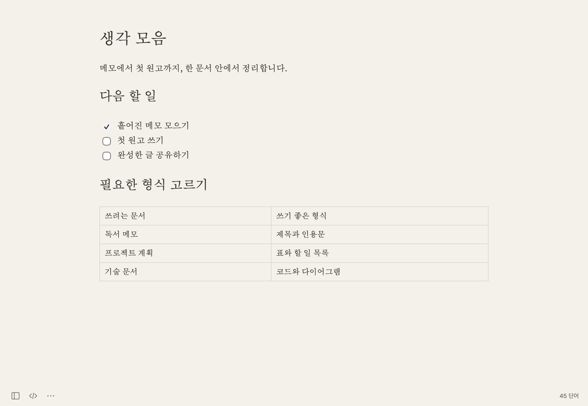

# Inkleaf

**Mac용 Markdown 편집기입니다.** 짧은 메모부터 긴 원고, 기술 문서까지 쓰고 정리할 수 있습니다. 문서는 일반 텍스트 파일로 저장됩니다.

[macOS 다운로드](https://github.com/Qualop/inkleaf/releases/latest) · [사용 가이드](docs/guide/ko/README.md) · [English](README.md)

## Inkleaf로 쓰면 좋은 점

- **서식을 보면서 씁니다.** 제목, 목록, 인용문, 표가 문서 형태로 표시됩니다. Markdown 기호를 직접 확인하고 싶으면 원문 보기로 전환할 수 있습니다.
- **파일을 원하는 곳에 보관합니다.** 일반 Markdown 파일을 열고 저장합니다. 글을 쓰는 데 계정이나 구독이 필요하지 않습니다.
- **글에 집중할 수 있습니다.** 기본 화면에는 작은 도구만 남습니다. 필요할 때 개요를 열거나, 집중 모드와 타자기 모드로 긴 글을 이어 쓸 수 있습니다.
- **설명에 필요한 자료를 한곳에 둡니다.** 코드, 로컬 이미지, TeX 수식, Mermaid 다이어그램을 본문에 넣을 수 있습니다. 수식과 다이어그램은 오프라인에서도 표시됩니다.

## 주요 기능

| 쓰려는 작업 | 제공하는 기능 |
| --- | --- |
| 메모와 원고 작성 | 서식을 보며 편집, Markdown 원문, 읽기 미리보기, 제목·목록·링크·인용문 |
| 문서 구조 정리 | 표 편집, 할 일 목록, 각주, 참조 링크, YAML 머리말 |
| 문서 탐색 | 폴더 탐색, 빠른 열기, 제목 개요, 문서·폴더 검색 |
| 기술 문서 작성 | 코드 구문 강조, TeX 수식, Mermaid 다이어그램, 로컬 이미지 관리 |
| 쓰기 환경 조절 | 문서 테마, 사용자 CSS, 글꼴, 집중 모드, 타자기 스크롤, 앱 아이콘 선택 |
| 한국어와 영어 사용 | 화면 언어 선택, 맞춤법 제안, 개인 사전 |
| 저장과 공유 | 임시 문서 복구, 이전 작업 복원, 선택적 자동 저장, PDF·HTML·이미지·Word·EPUB 내보내기 |
| 앱 업데이트 | 앱 안에서 새 버전 확인, 서명이 검증된 업데이트 다운로드 |

## 바로 시작하기

다운로드 빌드는 **Apple Silicon Mac과 macOS 14.5 이상**을 지원합니다.

1. [릴리스](https://github.com/Qualop/inkleaf/releases/latest)에서 **DMG**를 내려받고 Inkleaf를 응용 프로그램 폴더로 옮깁니다. **PKG** 설치 파일도 사용할 수 있습니다.
2. 앱을 열어 글을 쓰거나 **⌘O**로 기존 Markdown 파일을 엽니다.
3. **⌘S**를 눌러 문서를 저장할 위치를 정합니다.

이후 버전은 **Inkleaf → 업데이트 확인…**에서 설치할 수 있습니다. 설치와 업데이트 방법은 [시작하기](docs/guide/ko/getting-started.md)에 정리했습니다.

## 사용법 찾아보기

주제별로 나눈 페이지에 사용 순서, 예제, 실제 화면을 담았습니다.

- [설치와 시작하기](docs/guide/ko/getting-started.md)
- [글쓰기와 Markdown](docs/guide/ko/writing.md)
- [파일·검색·복구](docs/guide/ko/files-and-recovery.md)
- [이미지·수식·다이어그램](docs/guide/ko/images-math-diagrams.md)
- [내보내기와 인쇄](docs/guide/ko/export-and-print.md)
- [화면과 설정](docs/guide/ko/appearance-and-settings.md)
- [키보드 단축키](docs/guide/ko/shortcuts.md)
- [문제 해결](docs/guide/ko/troubleshooting.md)

[한국어 가이드 첫 페이지](docs/guide/ko/README.md) · [English guide](docs/guide/README.md) · [예제 문서](docs/examples)

## 함께 만들기

문제가 생기면 앱 버전, macOS 버전, 문제가 나타나는 순서를 알려 주세요. 가능하면 개인정보가 없는 짧은 예제 문서도 함께 남겨 주세요.

[소스에서 빌드하기](docs/building.md) · [기여 안내](CONTRIBUTING.md) · [문제 제보](https://github.com/Qualop/inkleaf/issues)

## 라이선스

Inkleaf는 [MIT 라이선스](LICENSE)로 공개된 오픈소스 앱입니다. 함께 배포하는 구성 요소에는 각 라이선스가 적용됩니다. 자세한 내용은 [외부 구성 요소 안내](THIRD_PARTY_NOTICES.md)를 참고하세요.
