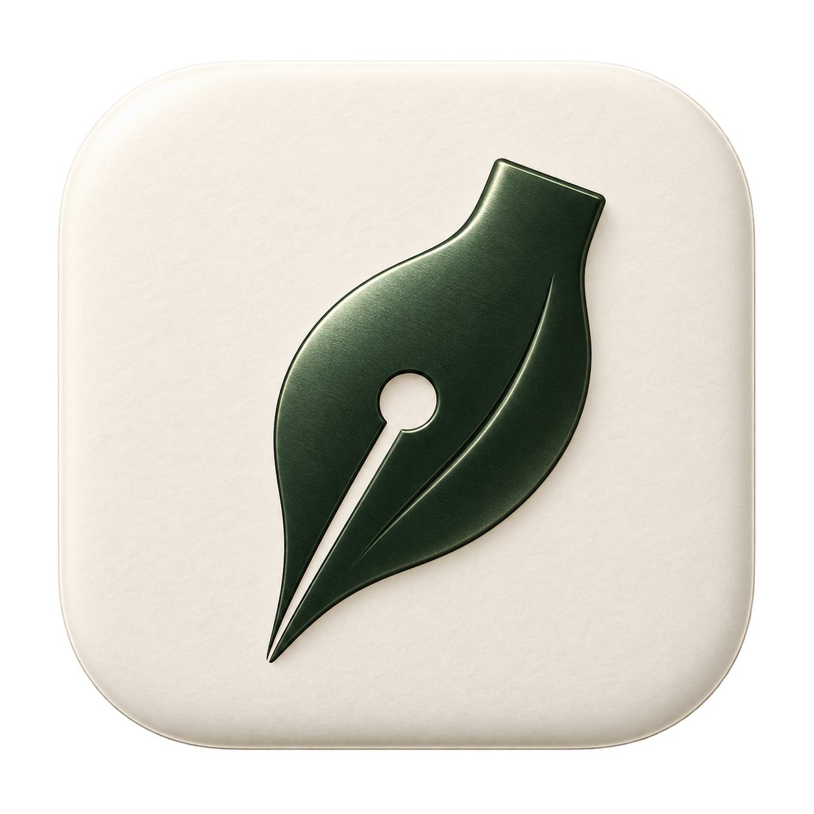

# Inkleaf


A quiet Markdown writing app for macOS. Write with live formatting, inspect the source, or switch to a reading preview. Local files, no account, no subscriptions.

[Download the latest release](https://github.com/Qualop/inkleaf/releases/latest) · [한국어 안내](#한국어-안내) · [MIT License](LICENSE)

## Install on macOS

Requires **Apple Silicon and macOS 14.5 or later** for the downloadable build.

- **DMG:** open it and drag Inkleaf into Applications.
- **PKG:** open the installer to install Inkleaf into Applications.

This first community release uses a local ad-hoc code signature. It is **not Developer ID signed or notarized**. macOS may require approval in System Settings → Privacy & Security. Checksums accompany the release. No administrator helper or background service is installed.

## Writing

- Live formatting, Markdown source and reading preview share one document and undo history.
- Files, folders, outline, search/replace, tables, task lists, footnotes and YAML front matter.
- Offline TeX mathematics and Mermaid diagrams; local image management.
- Themes, custom CSS, focus/typewriter modes, typography and document statistics.
- Korean and English menus, spelling suggestions and a personal dictionary.
- Local draft recovery, session restoration and optional automatic saving. Automatic saving is off by default.
- HTML, PDF, images, Word, EPUB and other exports. The Mac release includes a separately licensed Pandoc executable.

## App icon

Open **Settings → Appearance → App Icon**. Choose **Black Ink** (default, concept 3) or **Green Leaf** (concept 1).

 

The choice is global, takes effect immediately, and is restored on launch. On macOS it changes the running app's Dock and app-switcher icon; Finder and the installers retain the default Black Ink icon. Resetting preferences restores Black Ink.

## Build from source

Use Node.js 24 and a Swift 6.4 toolchain with the macOS SDK.

```sh
npm ci
npm run prepare:pandoc
npm test
npm run test:native
npx tsc --noEmit
npm run build
npm run package:mac -- --skip-build
```

`prepare:pandoc` downloads the pinned official Apple Silicon archive and verifies both archive and executable SHA-256. You can omit this step and configure a local converter in Settings instead. The app is built at `build/Inkleaf.app`; DMG, PKG and checksums are written to `dist/`.

For an isolated development profile:

```sh
open -na build/Inkleaf.app --args --data-dir "$PWD/.state"
```

The native Swift executable keeps the internal target name `Mori` for compatibility with existing tests. User-facing names and the executable product are Inkleaf. Existing Mori profile folders are reused intact; new installations store local settings and drafts in `~/Library/Application Support/Inkleaf`.

## Limits and privacy

Inkleaf is an early open-source release. It has no account service or built-in telemetry. User-configured image uploaders and external image URLs can make network requests. Dictionary, grammar and IME behavior depend on the host system; full Korean grammar checking, physical printers, external uploaders are not exhaustively verified.

Your documents remain local files. Unsaved drafts are local recovery data, not saved copies of the original files. See [release notes](docs/release.md) and [architecture](docs/architecture.md).

## License

Original application code and included icon artwork: [MIT](LICENSE). Dependencies retain their own licenses, including the separately invoked GPL-licensed Pandoc binary. See [third-party notices](THIRD_PARTY_NOTICES.md).

## 한국어 안내

Inkleaf는 로컬 Markdown 파일을 작성하는 앱입니다. DMG를 열어 응용 프로그램 폴더로 드래그하거나 PKG 설치 파일을 실행하세요. 다운로드 빌드는 Apple Silicon Mac과 macOS 14.5 이상을 지원합니다.

설정의 **모양과 테마 → 앱 아이콘**에서 기본 검은 잉크와 초록 잎 아이콘을 선택할 수 있습니다. 선택은 앱 전체에 저장되며 재실행해도 유지됩니다. Finder와 설치 파일에는 기본 아이콘을 사용합니다.

첫 공개 빌드는 Developer ID 서명과 Apple 공증을 받지 않았습니다. macOS에서 실행 승인을 요청할 수 있습니다. 기존 Mori 문서·설정은 보존하며 새 설치에서는 Inkleaf 데이터 폴더를 사용합니다.

## Mac updates

From 0.1.3, use Inkleaf > Check for Updates… to install new signed releases. Automatic checks can be toggled in the same menu. Older versions need one ordinary installation. See [update instructions](docs/updates.md).
