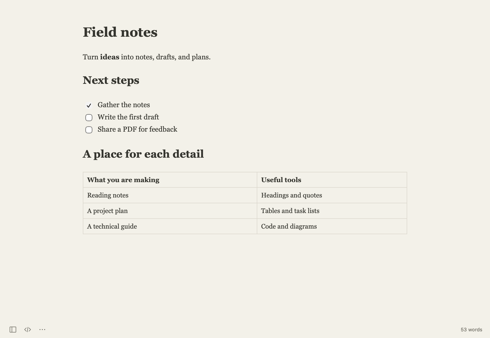

# Inkleaf

**A Markdown editor for Mac.** Write notes, draft longer pieces, and explain technical ideas in a document that stays a plain text file.

[Download for macOS](https://github.com/Qualop/inkleaf/releases/latest) · [User guide](docs/guide/README.md) · [한국어](README.ko.md)

## Why Inkleaf?

- **Write with formatting in view.** Headings, lists, quotes, and tables take shape as you work. Switch to Markdown source whenever you want to see the markup.
- **Keep your files.** Open and save ordinary Markdown files in folders you choose. Writing does not require an account or subscription.
- **Give the document room.** A small set of controls stays out of the way. Open the outline when you need it, or use focus and typewriter modes for longer drafts.
- **Keep the details together.** Put code, local images, TeX equations, and Mermaid diagrams alongside your explanation. Math and diagram rendering work offline.

## What you can do

| For | Inkleaf includes |
| --- | --- |
| Notes and drafts | Live formatting, source editing, reading preview, headings, lists, links, and quotes |
| Structured documents | Editable tables, task lists, footnotes, references, and YAML front matter |
| Finding your place | Folder browsing, quick open, heading outline, and document or folder search |
| Technical writing | Highlighted code blocks, TeX math, Mermaid diagrams, and local image tools |
| Your writing setup | Document themes, custom CSS, fonts, focus mode, typewriter scrolling, and two app icons |
| Korean and English | Interface languages, spelling suggestions, and a personal dictionary |
| Saving and sharing | Local draft recovery, session restoration, optional auto-save, PDF, HTML, images, Word, and EPUB export |
| Staying current | In-app update checks and signed update downloads |

## Start writing

The downloadable Mac build requires **Apple Silicon and macOS 14.5 or later**.

1. Download the **DMG** from [Releases](https://github.com/Qualop/inkleaf/releases/latest) and drag Inkleaf into Applications. A **PKG** installer is also available.
2. Open Inkleaf and start typing, or open an existing Markdown file with **⌘O**.
3. Press **⌘S** to choose where your document is saved.

Use **Inkleaf → Check for Updates…** for later releases. See [installation and updates](docs/guide/getting-started.md) for setup details.

## Learn Inkleaf

The guide is organized as linked pages, with examples and screenshots.

- [Getting started](docs/guide/getting-started.md)
- [Writing and Markdown](docs/guide/writing.md)
- [Files, search, and recovery](docs/guide/files-and-recovery.md)
- [Images, equations, and diagrams](docs/guide/images-math-diagrams.md)
- [Exporting and printing](docs/guide/export-and-print.md)
- [Appearance and settings](docs/guide/appearance-and-settings.md)
- [Keyboard shortcuts](docs/guide/shortcuts.md)
- [Troubleshooting](docs/guide/troubleshooting.md)

[English guide](docs/guide/README.md) · [한국어 사용 가이드](docs/guide/ko/README.md) · [Example documents](docs/examples)

## Contribute

Bug reports and focused improvements are welcome. Include the app version, your macOS version, and the steps needed to reproduce a problem. Use a small example document when possible.

[Build from source](docs/building.md) · [Contributing](CONTRIBUTING.md) · [Report an issue](https://github.com/Qualop/inkleaf/issues)

## License

Inkleaf is open source under the [MIT License](LICENSE). Bundled components retain their own licenses; see [third-party notices](THIRD_PARTY_NOTICES.md).
