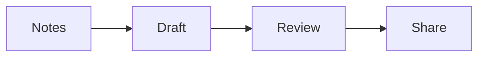

# Ideas, explained

Equations, diagrams, and code stay with the text.

$$
a^2 + b^2 = c^2
$$



```python
def reading_time(words, words_per_minute=200):
    return max(1, round(words / words_per_minute))
```
