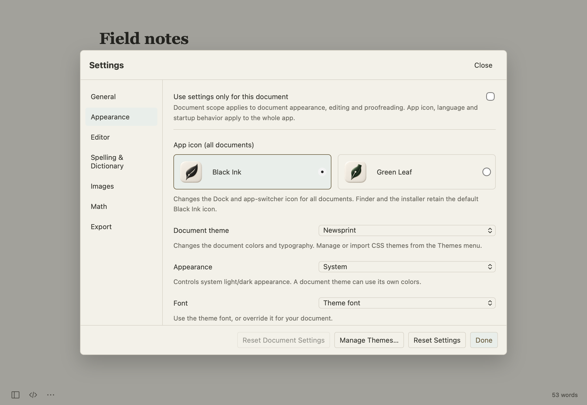

[Guide home](README.md) · [한국어](ko/appearance-and-settings.md)

# Appearance and settings

Open **Inkleaf → Settings…** with **⌘,**. The categories group related controls.

| Category | Controls |
| --- | --- |
| General | Interface language, reopening documents, unsaved drafts, auto-save, external file changes |
| Appearance | Theme, fonts, width, line spacing, focus, typewriter scrolling, custom CSS, app icon |
| Editor | Writing mode, wrapping, line numbers, indentation, pairing, Markdown preferences |
| Spelling & Dictionary | Spelling and grammar controls, checking language, personal words |
| Images | Optional external uploader configuration |
| Math | Equation numbering and physics support |
| Export | Custom Pandoc executable |

## Choose a document theme

Use **Themes** for the built-in Default, GitHub, Newsprint, Night, Pixyll, and Whitey themes. Theme management can import CSS, edit a user theme, and delete it. Appearance settings also control fonts, text size, document width, and line spacing.

## Set up one document differently

Enable **Use settings only for this document** in Settings before changing its appearance, editing, or proofreading preferences. Use **Reset Document Settings** to return that document to global settings.

App icon, interface language, and startup behavior remain global. The scope note in Settings explains which controls are document-specific.

## Choose an icon

In **Appearance → App icon**, choose **Black Ink** or **Green Leaf**. Black Ink is the default. The choice changes the running app's Dock and app-switcher icon. Finder and the installer keep the default icon.

## Spelling and personal words

Set the checking language to automatic, Korean, or English in **Spelling & Dictionary**. A red underline marks a possible spelling issue; grammar suggestions use a separate mark. Click a mark or use **⌥Return** for suggestions. A suggestion changes text only when you choose it.

Keep personal dictionary entries one per line. Grammar and dictionary results depend on macOS language support; they are suggestions, not a guarantee that a sentence is correct.

Update preferences are in the **Inkleaf** menu: **Check for Updates…** and **Automatically Check for Updates**.

---

[← Exporting and printing](export-and-print.md) · [Keyboard shortcuts →](shortcuts.md)
