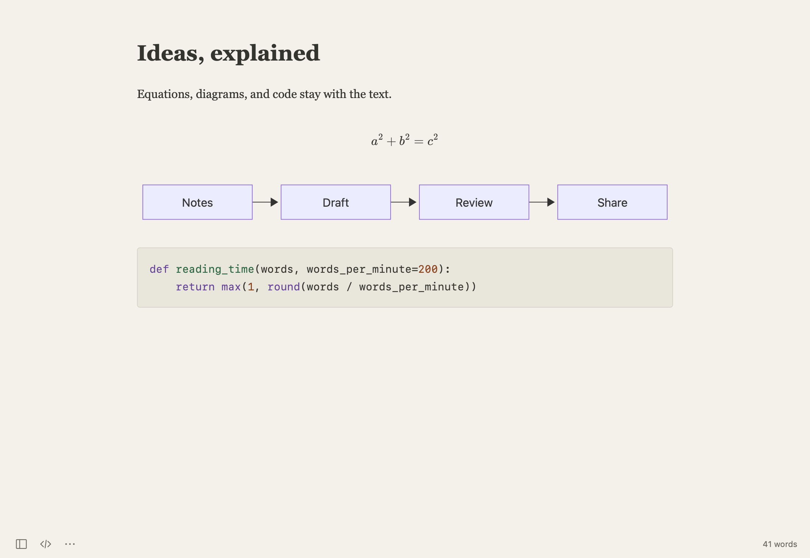

[Guide home](README.md) · [한국어](ko/images-math-diagrams.md)

# Images, equations, and diagrams

## Insert a local image

1. Put the caret where the image belongs.
2. Choose **Format → Image → Insert Local Image…** and select an image.
3. Save the document. For an untitled draft, the first save publishes referenced images with the document.

You can also paste an image from the clipboard or drop one into the document. Place the caret on an image reference and use **Format → Image** for properties, preview, and file-management actions.

```markdown

```

Relative links keep a document and its images portable when you move them together. Use Save As for a document that needs to carry its referenced images into another folder. Keep the accompanying `assets` folder when sharing the Markdown.

Remote image URLs can make network requests. External image uploaders are optional and must be configured in **Settings → Images**; local image insertion needs no uploader.

## Write an equation

Use dollar delimiters for inline math, or a separate display block:

```markdown
Inline: $E = mc^2$

$$
a^2 + b^2 = c^2
$$
```

Choose equation numbering and the physics package in **Settings → Math**. Math renders locally. The **Format → Math** menu also provides commands for copying or saving selected equations in supported formats.

## Draw a diagram with text

Use a fenced `mermaid` block:

````markdown

````

The diagram renders in Write and Preview. Edit its source to change it. Diagram commands under **Format → Diagram** can copy or save the selected diagram as SVG.



Try the [Technical Notes example](../examples/Technical%20Notes.md). If a formula or diagram fails to render, check its source syntax before changing the document around it.

---

[← Files, search, and recovery](files-and-recovery.md) · [Exporting and printing →](export-and-print.md)
