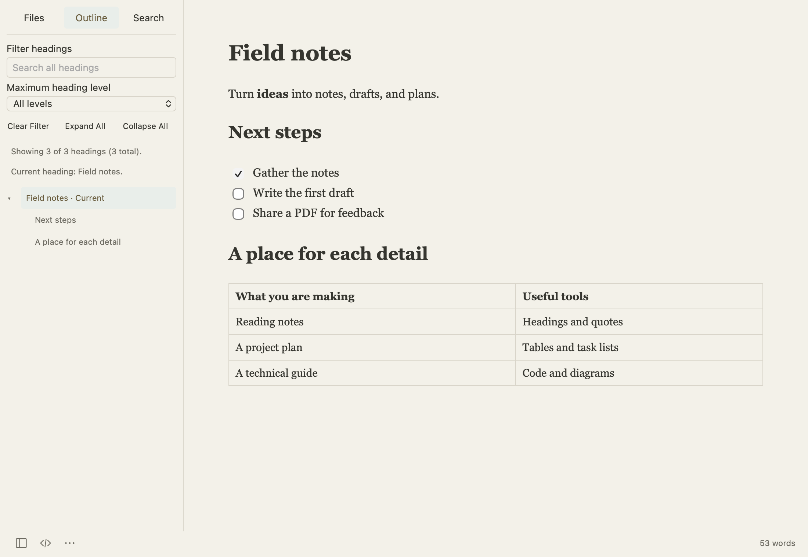

[가이드 첫 페이지](README.md) · [English](../files-and-recovery.md)

# 파일·검색·복구

## 파일과 폴더 열기

- **파일 → 열기…**(**⌘O**)로 문서를 엽니다.
- **파일 → 폴더 열기…**(**⇧⌘O**)로 사이드바에서 폴더를 탐색합니다.
- **파일 → 빠른 열기…**(**⌥⌘O**)로 최근 파일과 앱이 알고 있는 파일을 이름으로 찾습니다.
- **보기 → 파일 목록**에서 열린 문서와 폴더를 봅니다.

문서를 둘 폴더는 직접 정합니다. 별도의 프로젝트 형식으로 만들 필요가 없습니다.

## 제목을 따라 이동하기

**보기 → 개요**를 열고 제목을 누르면 해당 위치로 이동합니다. 제목 검색, 표시할 제목 단계 제한, 섹션 접기·펼치기로 긴 문서를 탐색할 수 있습니다.

## 검색과 바꾸기

**⌘F**를 누르고 검색어를 입력합니다. 다음·이전 버튼으로 일치하는 곳을 이동합니다. 대소문자, 정규식, 단어 단위 옵션으로 검색 조건을 바꿀 수 있습니다. 바꿀 문구를 입력한 뒤 한 곳 또는 전체를 바꿉니다.

여러 파일에서 찾으려면 먼저 폴더를 열고 **편집 → 찾기 → 폴더에서 찾기…**(**⇧⌘F**)을 선택합니다. 검색 결과를 누르면 해당 문서를 엽니다. 진행 중인 작업은 취소할 수 있습니다.

## 저장 상태 구분하기

| 상태 | 뜻 |
| --- | --- |
| 파일에 저장됨 | 마지막으로 저장한 내용이 선택한 위치의 파일에 있습니다. |
| 파일에 저장하지 않은 변경 사항 | 열린 문서에 아직 파일로 쓰지 않은 수정이 있습니다. |
| 임시 문서 보관됨 | 앱이 로컬 복구 데이터를 보관했습니다. 원본 파일에 저장한 상태와는 다릅니다. |

**⌘S**로 저장합니다. 다른 위치에 저장하려면 **파일 → 별도 저장…**(**⇧⌘S**)을 선택합니다. 로컬 이미지가 있는 문서를 다른 폴더로 옮길 때는 이 명령을 사용하면 참조한 이미지를 함께 저장할 수 있습니다.

자동 저장은 기본으로 꺼져 있습니다. **설정 → 일반 → 변경한 파일 자동 저장**에서 켤 수 있습니다. 새 문서는 먼저 저장 위치를 정해야 일반 파일로 자동 저장됩니다.

## 끝내지 못한 작업 복원하기

**설정 → 일반**에서 문서 다시 열기와 저장하지 않은 임시 문서 보관을 설정합니다. **파일 → 저장하지 않은 문서 복구…**에서 복구할 문서를 선택합니다. 복구한 내용을 파일에 쓰려면 저장하세요.

다른 앱이 같은 파일을 바꾸면 디스크의 변경 여부를 확인합니다. 양쪽에서 수정했다면 열린 내용을 보존한 채 저장 방법을 선택합니다. 별도 사본을 남기려면 다른 이름으로 저장을 사용할 수 있습니다.

오른쪽 아래의 단어 수를 누르면 통계와 인코딩·줄 끝 형식 설정이 열립니다. 인코딩을 바꾼 뒤 저장해야 실제 파일 형식에 반영됩니다.

---

[← 글쓰기와 Markdown](writing.md) · [이미지·수식·다이어그램 →](images-math-diagrams.md)
