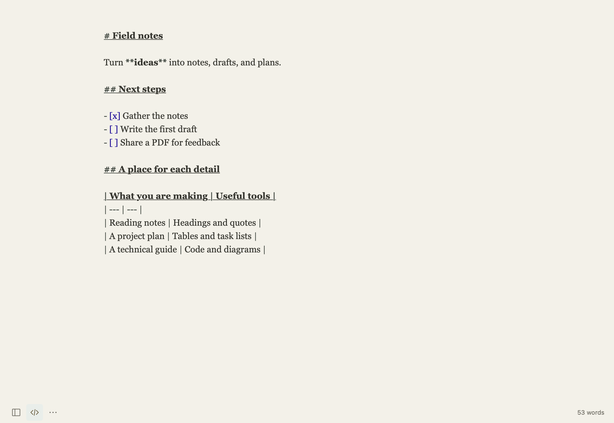

[Guide home](README.md) · [한국어](ko/writing.md)

# Writing and Markdown

## Three views, one document

| View | Use it for |
| --- | --- |
| **Write** | Edit with rendered headings, lists, tables, and other formatting. Markup appears where you edit. |
| **Markdown Source** | Inspect and change every Markdown character. |
| **Preview** | Read the formatted document without editing. |

Choose a view from **View**. The bottom-left source button is a quick way to toggle source editing. Changing views keeps the same document and edit history.



## Start with a few building blocks

````markdown
# A document title
## A section

A paragraph with **bold**, *italic*, and a [link](https://example.com).

> A quotation or a note to return to.

- A bullet
- Another bullet

- [ ] A task
- [x] A completed task

```python
print("Hello, notebook")
```
````

Use **Paragraph** for headings, lists, quotes, tasks, and block structure. Use **Format** for emphasis, links, and inline formatting. Select text first when you want to format an existing phrase.

## Work with tables

Choose **Paragraph → Insert / Edit Table…**. Enter the table data, add or remove rows and columns, set alignment, and apply. To change an existing table, put the caret in it before opening the same command. Undo returns to the previous Markdown.

```markdown
| Item | Status |
| --- | --- |
| Outline | Done |
| First draft | Next |
```

## Add references

Use **Format → Footnote** or **Reference Link…**, or type their Markdown directly:

```markdown
A useful observation.[^source]

[^source]: A reference or a longer note.
```

## Focus on the draft

**View → Focus Mode** dims other paragraphs. **Typewriter Mode** keeps the active line near the center as you write. You can change fonts, width, and spacing in [Appearance settings](appearance-and-settings.md).

---

[← Getting started](getting-started.md) · [Files, search, and recovery →](files-and-recovery.md)
